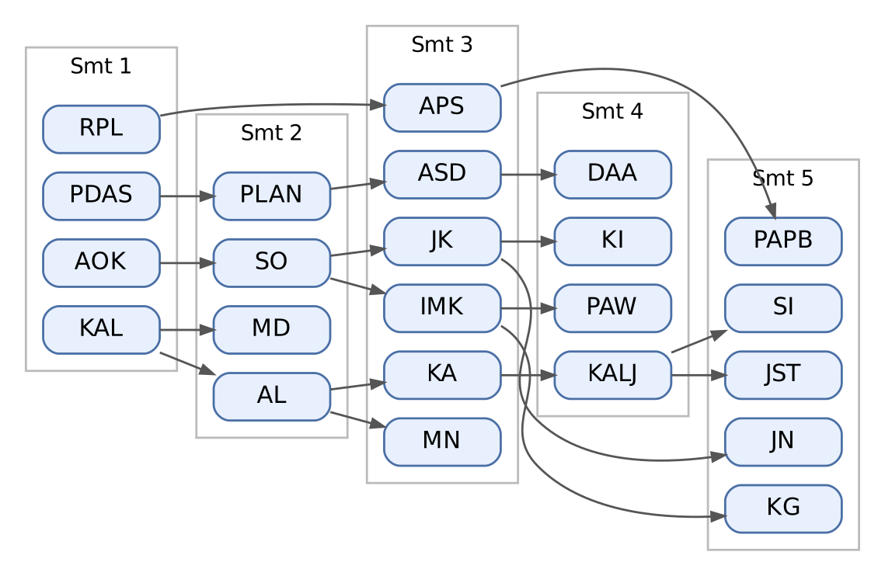

# Proyek 2 ASD: Sistem Rekomendasi Pengambilan Mata Kuliah

Program Java berbasis teks (console) yang membaca data mata kuliah, prasyarat, dan daftar MK yang
sudah lulus, lalu menampilkan:

1. **daftar MK yang bisa diambil** semester depan beserta total SKS, dan
2. **daftar MK yang belum bisa diambil** beserta alasannya (MK prasyarat apa saja yang belum lulus).

Struktur data utama: **graph berarah (directed graph) dengan adjacency list**, ditelusuri dengan
**DFS**. Semua struktur data dibuat sendiri, **tanpa `java.util`** (tidak memakai ArrayList,
HashMap, TreeMap, TreeSet, maupun library graph).

Mata kuliah: Algoritma dan Struktur Data, Teknik Informatika FILKOM UB.

## Anggota Kelompok

| No | Nama | NIM |
|---|---|---|
| 1 | Falisha Quinara Ramadhani | 255150207111005 |
| 2 | Ajrina Dinan Apissa | 255150207111014 |
| 3 | Nabillah Indah Hikmah Sari | 255150207111011 |
| 4 | | |

---

## Cara Menjalankan (± 1 menit)

### Kebutuhan
- **JDK 8 atau lebih baru** (sudah diuji dengan JDK 21 dan JDK 24).
  Cek dengan `java -version` dan `javac -version`.
- Tidak perlu library tambahan, Maven, atau Gradle.

### Langkah
1. Unduh repository: tombol hijau **Code → Download ZIP**, lalu ekstrak.
   Atau lewat git:
   ```
   git clone <link-repository-ini>
   ```
2. Buka terminal/Command Prompt **di folder repository** (folder yang berisi `src`, `data`, dan README ini).
3. Compile:
   ```
   javac -d out src/*.java
   ```
   Tidak ada pesan apa pun = compile berhasil.
4. Jalankan dengan tiga berkas input (`matakuliah.csv`, `prasyarat.csv`, `mhs_xx.txt`):
   ```
   java -cp out Main data/matakuliah.csv data/prasyarat.csv data/mhs_01.txt
   java -cp out Main data/matakuliah.csv data/prasyarat.csv data/mhs_02.txt
   java -cp out Main data/matakuliah.csv data/prasyarat.csv data/mhs_03.txt
   ```

> **Windows (Command Prompt):** ganti `/` dengan `\`, contoh:
> `javac -d out src\*.java` lalu
> `java -cp out Main data\matakuliah.csv data\prasyarat.csv data\mhs_01.txt`

> **Tanpa argumen**, `java -cp out Main` otomatis memakai `data/mhs_01.txt`.

### Lewat IDE (VS Code / IntelliJ / NetBeans)
Buka folder repository, buka `src/Main.java`, lalu klik **Run**. Hasil untuk `mhs_01` tampil di
panel output/terminal. Untuk berkas mahasiswa lain, isi *program arguments* dengan
`data/matakuliah.csv data/prasyarat.csv data/mhs_02.txt`, atau pakai terminal bawaan IDE dengan
perintah di atas.

### Contoh output (`mhs_01.txt`)
```
File mahasiswa      : data/mhs_01.txt
Semester berikutnya : genap

Daftar MK yang bisa diambil:
1. BD Basis Data 3 SKS
2. PLAN Pemrograman Lanjut 5 SKS
3. SO Sistem Operasi 5 SKS
4. MD Matematika Diskret 2 SKS
5. AL Aljabar Linear 2 SKS
6. EP Etika Profesi 2 SKS
7. BING Bahasa Inggris 2 SKS
8. PANC Pancasila 2 SKS
9. KWU Kewirausahaan 2 SKS
10. KWN Kewarganegaraan 2 SKS
11. CAP Capstone Project 3 SKS
Total: 30 SKS

Daftar MK yang belum bisa diambil semester depan:
PAW: belum lulus SO, IMK
DAA: belum lulus PLAN, ASD
KI: belum lulus SO, JK
KALJ: belum lulus AL, KA
SKR: semua MK wajib harus lulus dulu (kurang 29 MK: BD, PLAN, SO, MD, AL, EP, BING, ...)
```
Output lengkap ketiga berkas ada di folder [`contoh_output/`](contoh_output/).

---

## Aturan Pengambilan MK

Sesuai instruksi proyek, sebuah MK **bisa diambil** jika lolos semua pengecekan berikut:

| Cek | Aturan | Jika gagal |
|---|---|---|
| 1 | MK belum lulus | tidak ditampilkan |
| 2 | MK ditawarkan pada semester berikutnya (ganjil/genap; Skripsi = keduanya) | tidak ditampilkan |
| 3 | Semua prasyarat sudah lulus, **langsung maupun tidak langsung** | masuk daftar "belum bisa", alasan: `belum lulus ...` |
| 4 | Khusus Skripsi (SKR): semua MK wajib lain sudah lulus | masuk daftar "belum bisa", alasan: daftar MK yang kurang |

MK tanpa prasyarat (tidak ada garis masuk pada peta MK) bebas diambil selama lolos cek 1 dan 2.

**Prasyarat tidak langsung** ikut diperiksa. Contoh: KALJ butuh KA, dan KA butuh AL. Mahasiswa
yang belum lulus AL dan KA mendapat alasan `KALJ: belum lulus AL, KA`, diurutkan dari MK yang
harus diambil lebih dulu.

---

## Struktur Data



*Graph prasyarat dari `prasyarat.csv` (panah: prasyarat → MK).*

| Kelas | Isi / Peran |
|---|---|
| `MyLinkedList<T>` | Singly linked list generik buatan sendiri (`head`, `tail`, `size`, `add` O(1), `Cursor` untuk iterasi). Dipakai sebagai daftar vertex, adjacency list, dan daftar hasil. |
| `MataKuliah` | **Vertex** graph: kode, nama, SKS, semester, ganjil/genap, status lulus, `prasyarat` (adjacency list), `wasVisited` (penanda DFS). |
| `GraphKurikulum` | **Directed graph**: tambah vertex/edge, cari MK (sequential search), DFS prasyarat yang belum lulus. |
| `SistemRekomendasi` | Aturan pengambilan MK (cek 1 sampai 4). |
| `FileReaderUtil` | Membaca dan mengurai ketiga berkas input. |
| `Main` | Titik masuk program dan pencetakan hasil. |

**Kenapa graph?** Prasyarat membentuk rantai (KAL → AL → KA → KALJ → JST), dan bentuk rantai
seperti ini paling tepat dimodelkan sebagai directed graph: vertex = MK, edge = hubungan prasyarat.

**Kenapa adjacency list, bukan adjacency matrix?** Graph-nya jarang (sparse): 37 vertex tetapi
hanya 19 edge. Matriks 37×37 berisi 1369 sel yang hampir semuanya 0, sedangkan adjacency list
hanya menyimpan edge yang ada.

**Arah edge.** Edge disimpan dari MK ke prasyaratnya, sehingga pertanyaan "MK ini butuh apa?"
cukup dijawab dengan menelusuri dari MK itu sendiri.

## Algoritma

1. Baca `matakuliah.csv`: setiap baris menjadi satu vertex.
2. Baca `prasyarat.csv`: baris `X;Y` (Y butuh X) menjadi edge Y → X.
3. Baca `mhs_xx.txt`: simpan ganjil/genap dan tandai MK yang sudah lulus.
4. Untuk setiap MK yang belum lulus dan ditawarkan, jalankan **DFS** ke prasyaratnya:
   - tandai vertex dengan `wasVisited` supaya tidak dikunjungi dua kali,
   - berhenti di MK yang sudah lulus (rantai di atasnya pasti sudah terpenuhi),
   - catat MK yang belum lulus secara **post-order** (MK paling dasar lebih dulu),
   - setelah selesai, semua `wasVisited` dikembalikan ke `false`.
5. Hasil DFS kosong = MK bisa diambil; tidak kosong = masuk daftar "belum bisa" beserta alasannya.

**Kompleksitas:** satu kali DFS O(V + E); pengecekan semua MK O(V·(V + E)). Untuk V = 37 dan
E = 19, program selesai seketika.

Penjelasan lengkap ada di [laporan PDF](laporan/Laporan_Proyek2_ASD.pdf).

---

## Hasil Pengujian

| Berkas | Semester berikutnya | MK yang bisa diambil |
|---|---|---|
| `mhs_01.txt` | genap | BD, PLAN, SO, MD, AL, EP, BING, PANC, KWU, KWN, CAP (30 SKS) |
| `mhs_02.txt` | ganjil | PAPB, MPPI, BIND, PKL (12 SKS) |
| `mhs_03.txt` | ganjil | PAPB, JN, KG, JST, SI, MPPI, BIND, PKL (22 SKS) |

**Perbandingan dengan contoh output di instruksi (mhs_01):** daftar yang bisa diambil
(SO, AL, PLAN, BING, BD, EP, MD, KWN, KWU, PANC) dan yang belum bisa (PAW, DAA, KI, KALJ)
sama dengan contoh. Tambahannya:
- **CAP** ditawarkan di semester genap dan tidak punya prasyarat, sehingga memenuhi semua aturan.
- **SKR** ditampilkan beserta alasannya (aturan khusus Skripsi).
- Pada contoh instruksi, alasan DAA tertulis `belum lulus , ASD`; program menampilkan rantai
  lengkapnya: `belum lulus PLAN, ASD`.

## Format Berkas Input

| Berkas | Format | Contoh |
|---|---|---|
| `matakuliah.csv` | `Kode;Nama;sks;semester;ganjil/genap` (baris 1 = header) | `AL;Aljabar Linear;2;2;Genap` |
| `prasyarat.csv` | `prasyarat;matakuliah` (baris 1 = header) | `KAL;AL` berarti AL butuh KAL |
| `mhs_xx.txt` | dua baris `kunci=nilai` | `semester_berikutnya=genap` dan `lulus=RPL,PDAS,KAL` |

Untuk mencoba kasus lain, cukup buat berkas `mhs_xx.txt` baru dengan format yang sama.

## Struktur Folder

```
src/            kode program Java (6 kelas)
data/           berkas input: matakuliah.csv, prasyarat.csv, mhs_01..03.txt
contoh_output/  hasil program untuk ketiga berkas mahasiswa
laporan/        laporan PDF (maks. 3 halaman)
docs/           gambar graph prasyarat
```
